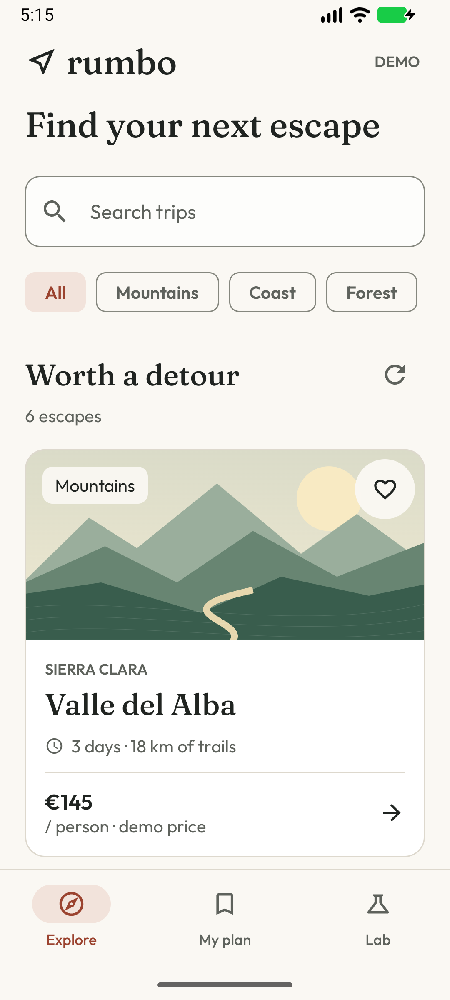
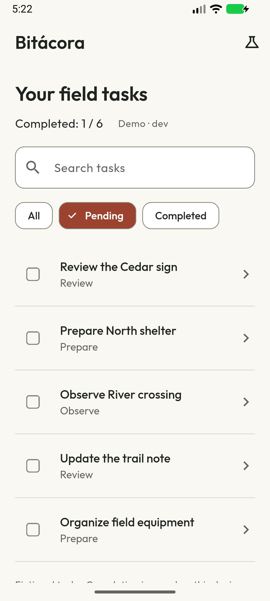

# Manuel Naval

**Mobile engineer · Android · Flutter**

[Español](https://github.com/navalcode/navalcode/blob/main/README.es.md) · [Engineering notes](https://github.com/navalcode/navalcode/blob/main/ENGINEERING_GUIDE.md)

I develop and maintain mobile applications, with a strong Android background and Flutter experience. I work on architecture, asynchronous state, SDK integration and the behavior that matters when an app is interrupted, a request fails or stored data has to survive a restart.

This GitHub brings together my personal applications, focused technical labs and engineering tools. The repositories make the implementation, decisions and tests available to read and run.

**Start with [Rumbo](https://github.com/navalcode/rumbo-android)** for an Android application, or **[Spec Evidence Lab](https://github.com/navalcode/spec-evidence-lab)** for my approach to AI-assisted engineering.

## Working interfaces

Actual Android emulator captures, English UI and fictional data. Rumbo's landscapes are original Canvas illustrations. Open either project to inspect its implementation, failure paths and validation scope.

## Selected work

**[Rumbo](https://github.com/navalcode/rumbo-android) · Native Android**

Kotlin/Compose trip app: Retrofit boundary, Room persistence, Navigation and recovery from source failures. [Build, tests and emulator](https://github.com/navalcode/rumbo-android/actions/workflows/checks.yml).

**[Bitácora](https://github.com/navalcode/bitacora-flutter) · Flutter**

Task app with request generations, acknowledged local writes, Android flavors and English/Spanish UI. [Flutter and Android checks](https://github.com/navalcode/bitacora-flutter/actions/workflows/checks.yml).

**[Vehicle Session Lab](https://github.com/navalcode/vehicle-session-lab) · Kotlin/JVM**

Session boundary: callback ownership, cancellation, bounded reconnection and telemetry freshness. [Tests and executable demo](https://github.com/navalcode/vehicle-session-lab/actions).

**[Spec Evidence Lab](https://github.com/navalcode/spec-evidence-lab) · Python/CLI/MCP**

Trace acceptance criteria to JUnit evidence and check structured implementation proposals. English/Spanish text output preserves machine statuses and hashes. [Contract and protocol checks](https://github.com/navalcode/spec-evidence-lab/actions).

**[GNSS Diagnostics Lab](https://github.com/navalcode/gnss-diagnostics-lab) · Python/C**

Capture diagnostics: exact reference pairing, fix gaps, apparent jumps and a tested `ctypes` boundary. [Linux/macOS checks](https://github.com/navalcode/gnss-diagnostics-lab/actions).

Rumbo and Bitácora use fictional data and run without accounts or private services. Vehicle Session Lab uses a simulated gateway; GNSS Diagnostics Lab uses synthetic captures. Their READMEs describe what has been exercised and where hardware or production validation would be needed.

## Android and concurrency

My Android work uses Kotlin, Coroutines, Flow and Compose. I pay particular attention to who owns a coroutine, when work should be cancelled, how presentation state is exposed and what the user sees during loading, stale content and recovery.

Three smaller repositories let you inspect those behaviors independently:

- [Coroutine Lab](https://github.com/navalcode/coroutine-lab): structured concurrency, `launch`/`async`, exception propagation and Flow operators. Interactive traces distinguish cancellation from business failures; Cancel remains reachable while reading the guide.
- [Compose Effect Lab](https://github.com/navalcode/compose-effect-lab): effect keys, restarts, resource cleanup and `rememberUpdatedState`. Scrolling preserves the experiment owner; changing a key or leaving its screen still cancels/releases it. JVM tests and native journeys accompany the examples.
- [Coroutines Tests Mini](https://github.com/navalcode/android-coroutines-tests-mini): StateFlow, injectable dispatchers, fakes, virtual time and replacement of an in-flight query. The small Views screen guards duplicate loads and preserves results on recreation.

In Rumbo, those concerns meet in a complete application. Domain orchestration is separated from Android; repository and adapter contracts keep transport and storage replaceable. Retrofit DTOs are validated at the boundary, Room owns persisted state, and the ViewModel exposes read-only flows. The app uses a small explicit dependency graph. Its architecture notes explain that choice and the limits of activity recreation versus process restoration.

The three labs have bilingual controls and real emulator captures. Their READMEs separate JVM/CI checks from locally executed Android journeys and document the supported-language boundaries.

## Growing across mobile platforms

The current runnable examples cover Android/Kotlin and Flutter/Dart. Native iOS is the next extension: a Swift core for state and concurrency, followed by a SwiftUI flow with persistence and platform checks. The [mobile roadmap](https://github.com/navalcode/navalcode/blob/main/MOBILE_ROADMAP.md) tracks the planned increments and their validation gates.

## How I approach engineering

I use architecture to make behavior easier to change and test. Useful boundaries matter more to me than adding layers for their own sake.

- **State and lifecycle:** explicit ownership, cancellation and cleanup; immutable state towards the UI; deliberate handling of late results.
- **Integration:** adapter contracts, third-party SDK behavior, background work, connectivity changes and platform compatibility.
- **Persistence:** clear write acknowledgement, repeatable operations and recovery that preserves useful data after a failure.
- **Testing:** fakes and virtual time for state transitions; integration and UI checks for behavior that needs the platform.
- **Maintenance:** pinned build tools, reproducible commands, reviewable changes and checks of optimized builds as well as debug behavior.

The [engineering review and release guide](https://github.com/navalcode/navalcode/blob/main/ENGINEERING_GUIDE.md) describes how I review these examples and separate code checks, emulator results and release preparation.

## AI-assisted engineering and spec-driven development

I use Codex and Claude alongside code inspection, implementation and review. My work includes contributions to shared engineering methods and project-specific workflows: architecture context, reusable task instructions, MCP tools, structured outputs, terminology and continuity between sessions. Shared contributions retain their attribution; the public examples here have their own implementation and scope.

I work from specifications that connect a problem to observable behavior:

1. Define the user need, constraints, assumptions and scope.
2. Describe states, contracts, cancellation, failure cases and acceptance criteria.
3. Record implementation choices and the alternatives considered.
4. Validate the result with behavior tests and reproducible commands.
5. Update the specification, decisions and task evidence so another contributor or agent can continue.

For an agent, that provides a concrete implementation contract. For a reviewer, it provides a way to compare the change with the intended behavior. I inspect generated code, check assumptions against the repository and keep validation results separate from proposed plans.

[Spec Evidence Lab](https://github.com/navalcode/spec-evidence-lab) makes part of that workflow executable. It checks acceptance evidence, JUnit results and structured proposals against a specification; supports English/Spanish summaries; and exposes an optional read-only MCP stdio adapter. Schema and consistency checks support human review of meaning and sufficiency.

## Earlier work

The account also contains coursework and earlier experiments in Android, Flutter, Java and web development. Their READMEs explain their scope and preserve the original authorship and notes. [Flutter Variants](https://github.com/navalcode/FlutterVariants) explores environment configuration; [Android Lottie Tutorial](https://github.com/navalcode/AndroidLottieTutorial) explores animation in Kotlin/Views.
